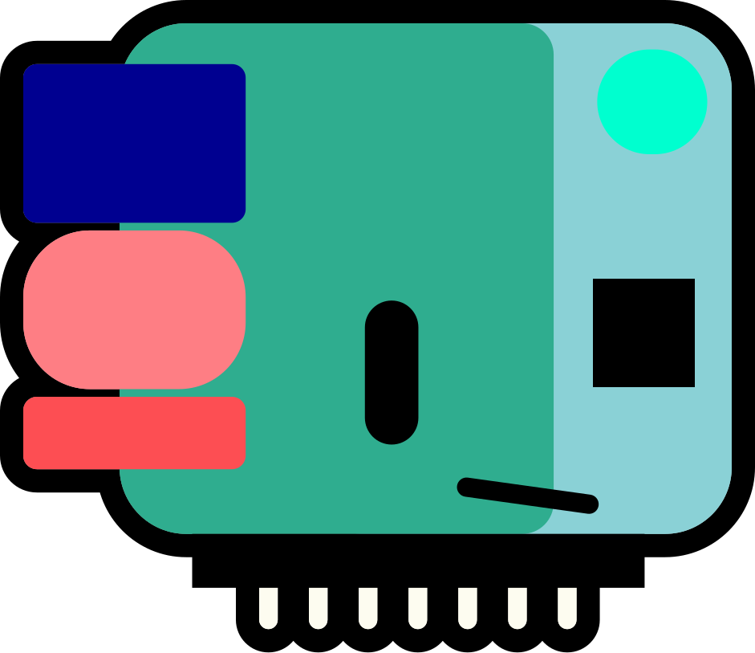
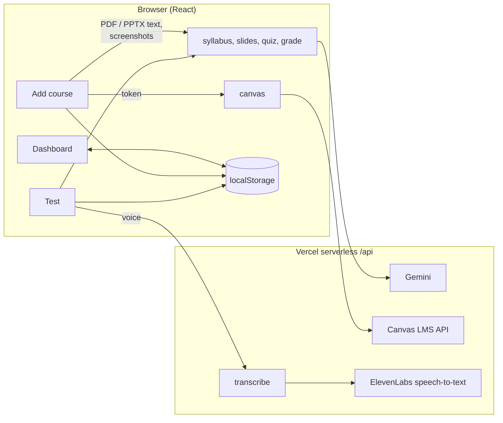

<p align="center">
  
</p>

<h1 align="center">LockedIn</h1>

<p align="center">
  <b>Your study sidekick. Jepi reads your courses, tells you what to study today, and won't let you call it done until you prove it.</b>
</p>

<p align="center">
  <a href="https://lockedin-seven-xi.vercel.app">Live app</a> |
  <a href="https://lockedin-seven-xi.vercel.app/?demo">Demo student</a> |
  <a href="https://youtu.be/fHYPNzhkvhI">How to get a Canvas token (video)</a>
  <br />
  Built for the <i>Digital Sidekick</i> hackathon
</p>

---

## Why LockedIn

University students rarely fail because they don't care. They fail because:

- **They don't know what to study today.** The syllabus is a 10-page PDF and the slides pile up every week.
- **They study the wrong things.** Hours on a topic worth 5%, nothing on the one worth 40%.
- **Rereading feels like learning, but it isn't.** You only know a topic when you can answer questions on it or explain it.
- **Motivation runs out**, even right before a deadline.

LockedIn turns a course into a daily habit, checks that you actually learned it, and keeps you going with a mascot that cheers you on and rewards you for showing up.

## What it does

| | |
|---|---|
| **Add a course, any way you like** | Connect **Canvas** (imports every course with its deadlines and grade weights), upload the **syllabus and slides** (PDF or PowerPoint, several at once), drop in **screenshots**, or **type it in**. Mix and match: everything merges into one course. |
| **Understands your grading** | Gemini pulls out each graded item, its weight, its date, and which topics it covers. Totals and their parts ("Project 40%" = proposal 10% + report 20% + ...) are recognised so nothing is counted twice. |
| **A habit for every course, every day** | Jepi picks today's topic per course: the weak topic that hurts your grade most first, then topics you haven't tried. |
| **Prove it** | Three ways to be tested: **multiple choice** (3 to 15 questions; easy, medium or exam-level), **write what you understood**, or **say it out loud** (recorded, transcribed, then graded like you're teaching Jepi). |
| **Progress that means something** | A daily ring (studied = half, passed a test = full) and a course **mastery score weighted by grades**, plus a progress bar for every topic. |
| **Motivation that pays** | A daily **streak**, **streak shields** (earned every 5 study days, used automatically when you miss a day), **days off** (earned every 3 passed tests), deadline warnings and a daily pep talk from Jepi. |
| **Jepi, everywhere** | The mascot reacts to everything you do, talks in the first person, and sits in the corner of every page. Tap it for a pep talk or your most urgent deadline. |

All your data stays in your browser (localStorage). No accounts, no database.

## Try it in 30 seconds


1. Open **[lockedin-seven-xi.vercel.app/?demo](https://lockedin-seven-xi.vercel.app/?demo)**. This loads a demo student with two courses, a 6-day streak and a midterm in 4 days.
2. On the **Dashboard**, click **Prove it** on *Software Design*, take the quiz, and watch the ring and mastery update.
3. Go to **Add course** and add one of your own courses.

To reset, open the `?demo` link again, or run `localStorage.clear()` in the browser console.

## How it works



| Step | Done by |
|---|---|
| Reading PDF and PowerPoint files | The browser (pdf.js, JSZip). Only the text is sent, which keeps requests small |
| Grading weights, dates, groups and topic coverage from a syllabus | Gemini (`/api/syllabus`) |
| A study summary for each topic from slides | Gemini (`/api/slides`), filed under the syllabus's topic names |
| Quiz questions and answer key | Gemini (`/api/quiz`) |
| Marking multiple-choice answers | The browser, against Gemini's answer key |
| Grading written and spoken explanations, and Jepi's reply | Gemini (`/api/grade`) |
| Speech to text for "say it out loud" | ElevenLabs (`/api/transcribe`) |
| Deadlines and grade weights from Canvas | Canvas API (`/api/canvas`), no AI |

**Reliability:** API keys live only on the server. If Gemini is busy, the server tries the next model in a fallback list (`gemini-3.6-flash`, then `3.5-flash`, then `3.5-flash-lite`). If all of them fail, it returns sample data with `fallback: true`, so the app never crashes mid-demo.

## Tech stack

- **Frontend:** React 19, Vite 6, Tailwind CSS v4, framer-motion, canvas-confetti
- **Files:** pdfjs-dist (PDF), JSZip (PowerPoint)
- **Backend:** Vercel serverless functions (`/api`), `@google/genai` (Gemini), ElevenLabs speech-to-text, Canvas LMS REST API
- **Storage:** the browser's localStorage

## Run it locally

You need Node 18+ and the Vercel CLI (use it through `npx`, no global install needed).

```bash
git clone https://github.com/LockedI-n/LockedIn.git
cd LockedIn
npm install
cp .env.example .env.local     # then fill in your keys (see below)
npx vercel link                # pick the existing "lockedin" project
set -a; source .env.local; set +a; npx vercel dev
```

Open **http://localhost:3000**.

- Use `vercel dev`, not `npm run dev`: only `vercel dev` runs the `/api` functions.
- `vercel dev` doesn't pass `.env.local` to the functions by itself, which is why the command loads it first with `source`.
- No keys yet? Everything still runs on sample data.

### Environment variables

| Name | Needed for | Where to get it |
|---|---|---|
| `GEMINI_API_KEY` | Everything AI (syllabus, slides, quizzes, grading) | [Google AI Studio](https://aistudio.google.com), free |
| `ELEVENLABS_API_KEY` | "Say it out loud" mode | [elevenlabs.io](https://elevenlabs.io) |

Put them in `.env.local` locally, and in **Vercel, then Settings, then Environment Variables** for the live site (then redeploy). Never put a key in `src/`. The Canvas token is typed in by each student on the Add course page and is never stored.

### Getting a Canvas token (for students)

Canvas, then **Account**, then **Settings**, then **Approved Integrations**, then **+ New Access Token**. Copy it and paste it on the Add course page. There's a short video walkthrough: [youtu.be/fHYPNzhkvhI](https://youtu.be/fHYPNzhkvhI) (also linked in the app, under "How do I get a Canvas token?"). The default Canvas address is SFU's (`CANVAS_DEFAULT_URL` in `src/lib/config.js`), and students can change it.

## Project structure

```
api/                       Vercel serverless functions (keys stay here)
  _gemini.js               Gemini helper, model fallback list, Jepi's personality
  _samples.js              sample responses used when the AI is unavailable
  syllabus.js              weights, dates, groups, covered topics, weekly topics
  slides.js                topic summaries (matched to the course's topic names)
  quiz.js                  multiple-choice questions (count + difficulty)
  grade.js                 grades written / spoken explanations in Jepi's voice
  canvas.js                lists Canvas courses, imports assignments + weights
  transcribe.js            speech to text through ElevenLabs
src/
  App.jsx                  tabs, navigation between pages, saving test results
  pages/
    Dashboard.jsx          Jepi's message, daily ring, streak + rewards, habits, courses
    Upload.jsx             Add course: Canvas / files / screenshots / manual
    Test.jsx               multiple choice, write it, say it out loud
  components/
    Sidekick.jsx           Jepi with moods and a speech bubble
    JepiBuddy.jsx          Jepi in the corner of every page
    HabitCard.jsx, ProgressRing.jsx, MasteryBar.jsx
    addcourse/             CanvasPanel, FilePanel, CourseEditor
  lib/
    api.js                 frontend calls to /api
    storage.js             localStorage + habit and score helpers
    courses.js             merging course data from different sources
    mastery.js             grade-weighted mastery
    motivation.js          streaks, shields, days off, pep talks
    pdfParser.js, pptxParser.js
    demoData.js            the ?demo student
    config.js              Jepi's name, mastery threshold (70), Canvas defaults
  index.css                colour palette (from the mascot) and fonts
docs/PERSON2_BACKEND.md    backend log: endpoint status, prompt changes, tests
```

## Data model

Everything is stored in localStorage under the key `study-sidekick`:

```js
{
  courses: [{
    id: "cmpt455",
    name: "CMPT 455",
    weights: [{
      item: "Midterm", percent: 20, date: "2026-10-21",   // date may be null
      group: "Exams",                                      // optional: heading the item sits under
      covers: ["Classification"],                          // optional: topics it tests; null = all
    }],
    topics: [{ name: "Classification", week: 3, summary: "...", score: 55 }],  // score null = not tested
  }],
  habits: [{ id: "cmpt455-2026-11-07", courseId: "cmpt455", topic: "Classification",
             date: "2026-11-07", studied: true, tested: false, score: null }],
  streaks: { shieldDays: ["2026-11-03"], offDays: [] },   // days covered by a shield / taken off
}
```

**Mastery** (`src/lib/mastery.js`): each graded item shares its percentage among the topics it covers, and a course's mastery is the weighted average of its topic scores. A topic on the 40% final counts more than one only on a 5% quiz.

## API reference

All endpoints are `POST` with a JSON body. Anything else returns `405`. AI endpoints may add `fallback: true` when they return sample data.

| Endpoint | Body | Returns |
|---|---|---|
| `/api/syllabus` | `{ courseName, text? , fileBase64?, mimeType? }` | `{ weights, topics }` |
| `/api/slides` | `{ courseName, text?, images?: [{ data, mimeType }], topics?: [string] }` | `{ topics: [{ name, summary }] }` |
| `/api/quiz` | `{ courseName, topic, summary, count?: 1-15, difficulty?: "easy" \| "medium" \| "hard" }` | `{ quiz: [{ question, options[4], answer, explanation }] }` |
| `/api/grade` | `{ courseName, topic, summary, mode: "written" \| "feynman", answer }` | `{ score, gotRight, missed, sidekickMessage }` |
| `/api/canvas` | `{ baseUrl, token, action: "courses" }` or `{ ..., action: "course", courseId }` | `{ courses }` or `{ course: { name, weights } }` |
| `/api/transcribe` | `{ audioBase64, mimeType }` | `{ transcript }` |

Base64 data never includes the `data:...;base64,` prefix. Vercel limits request bodies to about 4.5 MB, which is why files are turned into text in the browser first.

## Team

| | Area | Main files |
|---|---|---|
| **Person 1** (aozorai) | Uploads and content | `src/pages/Upload.jsx`, `src/components/addcourse/`, `src/lib/pdfParser.js`, `src/lib/pptxParser.js` |
| **Person 2** (MujtabaF, team lead) | AI and backend | `api/`, `src/lib/api.js`, `docs/PERSON2_BACKEND.md` |
| **Person 3** (Sunny) | Dashboard, Jepi, progress | `src/pages/Dashboard.jsx`, `src/components/`, `src/lib/storage.js`, `mastery.js`, `motivation.js` |
| **Person 4** (Kenneth) | Test modes and pitch | `src/pages/Test.jsx`, `api/transcribe.js` |

## Contributing (team rules)

1. **Always start from the latest `main`:** `git checkout main && git pull origin main`, then `git checkout -b yourname/what-you-are-doing`.
2. **Don't reuse old branches.** Merging stale branches back in has broken `main` before.
3. Put files in the right folder (`src/pages`, `src/components`, `src/lib`), never the repo root.
4. Before opening a PR, run the app and click through **Add course, then Dashboard, then Test**.
5. Never commit `.env` or `.env.local`.
6. Post in the team chat before merging. The live site is deployed from `main` with `npx vercel --prod`.

## Troubleshooting

| Problem | Fix |
|---|---|
| Everything shows sample data | The Gemini key is missing, or `vercel dev` wasn't started with `source .env.local` |
| `/api/...` returns 404 locally | You ran `npm run dev`. Use `npx vercel dev` |
| "Say it out loud" shows an error | `ELEVENLABS_API_KEY` is missing (locally or on Vercel), or the browser blocked the microphone |
| Canvas says the token was rejected | It was copied incompletely or has expired. Make a new one |
| `npm i -g vercel` fails with EACCES | Skip the global install and use `npx vercel ...` |
| Vite won't build on Node 22.11 | This repo pins Vite 6, which works on Node 18+. Update Node if you upgrade Vite |
